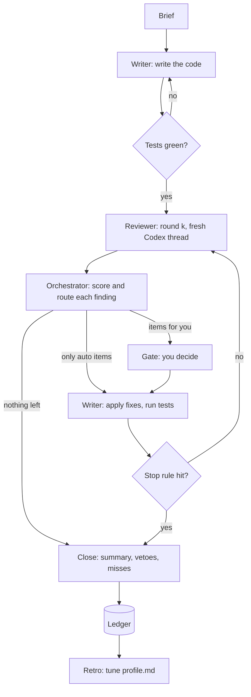

# dev-loop

dev-loop is a Claude Code skill that writes code with one model, reviews it with another,
and asks you only about the findings it can't safely settle on its own. Every answer you give
goes into a record, and the record decides what it may do without you next time. So it asks
less as it learns what you'd say.

## Why

Two things go wrong when you hand coding work to models.

First, you become the bottleneck. Every change waits for you to read a review, and most of
what you read is stuff you'd approve without thinking.

Second, both models add code. The writer adds a layer "for flexibility". The reviewer asks
for a null check, a retry, a cache, "just in case". The writer agrees, because writers
agree. After three rounds the code is twice the size and does the same thing.

dev-loop goes after both. It treats needless complexity as a defect, not a matter of taste,
and it tells the reviewer that the reviewer is a source of it too. And it hands work to
itself only as fast as your track record allows: trust grows after many agreements and
drops after one veto.

## Quick start

You need Claude Code, the Codex CLI (logged in), git and python3.

    git clone https://github.com/mo4islona/dev-loop ~/Projects/dev-loop
    ln -s ~/Projects/dev-loop ~/.claude/skills/dev-loop

Then, in any repo:

    /dev-loop add a timeout to the RPC client

To swap models for one run:

    /dev-loop writer=sonnet/medium reviewer=gpt-6-astra/xhigh add a timeout to the RPC client

## See the reviewer work

    demo/run

This builds a throwaway repo, drops in a small change with a wrong divisor and a class
hierarchy nobody needs, and runs two real review rounds against Codex. The second round
reviews a fix that brings in a new bug. It needs only the Codex CLI and takes a minute or
two. It doesn't run the writer: the change and the fix are files in `demo/`, so every run
has the same problems to find. (The reviewer's wording changes from run to run. It's a
model.)

Here's one run, unedited except for the temp path. The indented lines under each
`round` header are the live feed: they print while the reviewer works.

```
round 1: gpt-6-astra/high reads the change
  codex  I’ll read the implementation and test setup, then check the results for mixed, empty, and non-
         positive inputs.
  $ pwd; rg --files -g '!node_modules' -g '!target' -g '!package-lock.json' -g '!yarn.lock'; git status --short
  $ cat avg.js sum.js; node -e 'const {averagePositive}=require("./avg"); for (const xs of [[1,-1,3],[],[-1,0],[1…
  think  Summarizing bug analysis · Detailing bug fix and complexity changes
done in 47 s: verdict rethink, 2 findings

Round 1: verdict rethink, 2 findings
      Simpler shape: Use one averagePositive(xs) function: filter positive values, return 0
      when none remain, otherwise divide sumPositive(positives) by positives.length. Keep
      sum.js unchanged and add acceptance tests. No strategy classes or configurable
      implementation are needed.

R1-1  Both required examples return incorrect results
      bug, blocker · avg.js:12 · you decide: the fix changes behaviour
      To calculate the mean of positive numbers, averagePositive([1, -1, 3]) returns
      1.3333333333333333 instead of 2, and averagePositive([]) returns NaN instead of 0.
      Both results were reproduced by running the actual exported function.
      If skipped: Callers receive incorrect averages for mixed positive and non-positive
      arrays and NaN for empty arrays. Both acceptance criteria fail, and no tests cover
      them.
      Fix: Divide by the number of positive values, returning 0 when that count is zero. Add
      regression tests for both acceptance examples and an array without positive values.
        --- a/avg.js
        +++ b/avg.js
        @@ -12 +12,3 @@
        -    return sumPositive(xs) / xs.length;
        +    const positives = xs.filter(x => x > 0);
        +    if (positives.length === 0) return 0;
        +    return sumPositive(positives) / positives.length;
        --- /dev/null
        +++ b/avg.test.js
        @@ -0,0 +1,8 @@
        +const assert = require('node:assert/strict');
        +const test = require('node:test');
        +const { averagePositive } = require('./avg');
        +test('averages positive values and handles no positives', () => {
        +  assert.equal(averagePositive([1, -1, 3]), 2);
        +  assert.equal(averagePositive([]), 0);
        +  assert.equal(averagePositive([-1, 0]), 0);
        +});

R1-2  A simple average requires tracing two classes and a configurable wrapper
      complexity, major · avg.js:3 · you decide: the fix touches public_api
      To understand the positive-number average, a reader must follow an abstract class, its
      only implementation, default object construction, and a forwarding function. The
      repository has no callers needing another strategy.
      If skipped: Every reader and future change must account for an unnecessary extension
      point and an unused throwing implementation.
      Fix: Delete both classes and the strategy parameter. Move the compute body directly
      into averagePositive(xs), applying R1-1's arithmetic correction there. This preserves
      the required behavior. The full deletion diff exceeds 20 lines.

The human accepts R1-1 and rejects the rest as `later`. The writer applies a fix.

round 2: gpt-6-astra/high reads the change
  codex  I’ll check the fix, trace how `sumPositive` handles inputs, and look for regression tests.
  $ pwd; rg --files -g '!node_modules' -g '!target' -g '!package-lock.json'; git status --short
  $ nl -ba avg.js; nl -ba sum.js; node -e 'const {averagePositive}=require("./avg"); for (const xs of [[1,-1,3],[…
  think  Summarizing test fix changes
done in 28 s: verdict fix, 1 finding

Round 2: verdict fix, 1 finding

R2-1  Zeros incorrectly lower the average of positive values
      bug, major · avg.js:12 · incomplete fix of R1-1 · you decide: the fix changes behaviour
      To average positive numbers, averagePositive([0, 2]) should return 2, but returns 1.
      The denominator includes zero while sumPositive excludes it. Both acceptance examples
      pass, but the promised regression tests are also absent.
      If skipped: Arrays containing both zeros and positive numbers consistently produce an
      average below the correct result.
      Fix: Count only values greater than zero. Add regression tests for the acceptance
      examples, no positive values, and mixed zeros and positives.
        --- a/avg.js
        +++ b/avg.js
        @@ -12,1 +12,1 @@
        -    const count = xs.filter((x) => x >= 0).length;
        +    const count = xs.filter((x) => x > 0).length;
        --- /dev/null
        +++ b/avg.test.js
        @@ -0,0 +1,6 @@
        +const assert = require('node:assert/strict');
        +const { averagePositive } = require('./avg');
        +assert.equal(averagePositive([1, -1, 3]), 2);
        +assert.equal(averagePositive([]), 0);
        +assert.equal(averagePositive([-2, 0]), 0);
        +assert.equal(averagePositive([0, 2]), 2);
```

Round 1 found both problems. It ran the code to prove the bug, and its `rethink` verdict
would put the hierarchy question to you before any small fix ran. Round 2 didn't stop at
checking the fix it asked for: it found that the fix counts zeros, tied that back to R1-1,
and left the rejected hierarchy finding alone.

Every item here goes to you, because each fix changes behaviour or the function's signature.
With the starting profile, only low-risk fixes run without you.

## The loop



Four parties take part:

| Who | What runs it | Lifetime |
|---|---|---|
| Orchestrator | the Claude Code session where you typed `/dev-loop` | the task |
| Writer | a Claude subagent, Opus at high effort by default | one per task |
| Reviewer | Codex, `gpt-6-astra` at high reasoning by default, read-only | a new thread every round |
| You | the gate | only the findings routed to you |

The orchestrator writes no code. It frames the task, runs the other two, scores findings,
and keeps the record.

The writer lives for the whole task. Fix requests go back to the same agent, so it still
knows why it wrote what it wrote and can argue back.

The reviewer is the opposite: a new thread every round. A reviewer that remembers its last
round mostly checks its own old findings. A new one reads the change cold and finds what
the last one missed.

The writer and the reviewer are different models on purpose. A model reviewing code from
its own family tends to share that family's blind spots.

## One task, step by step

**1. Brief.** The orchestrator writes down the goal, the acceptance criteria as checkable
bullets, what's out of scope, the expected size (S, M or L) and the test command. It shows
you the brief only if it had to guess something.

**2. Write.** The writer gets the brief plus the rules it has learned from your past
reviews. It reports what it changed, what it assumed, and what it chose not to do. The
orchestrator then runs the tests itself. If they fail, the writer gets the output. After two
failed tries you get it.

**3. Review.** Codex reads the diff and the code around it, and returns findings as JSON:
category, severity, confidence, the concrete failure, the fix, and some facts about the fix
(lines it adds and removes, files it touches, whether callers see different behaviour,
which sensitive areas it touches).

A review takes a few minutes, and a silent wait that long looks like a hang. So you watch
it work: what the reviewer says and every command it runs come into the chat as they
happen.

    round 1: gpt-6-astra/high reads the change
      codex  I’ll read the implementation and test setup, then check the results for mixed, empty, and non-
             positive inputs.
      $ pwd; rg --files -g '!node_modules' -g '!target' -g '!package-lock.json' -g '!yarn.lock'; git status --short
      $ cat avg.js sum.js; node -e 'const {averagePositive}=require("./avg"); for (const xs of [[1,-1,3],[],[-1,0],[1…
      think  Summarizing bug analysis · Detailing bug fix and complexity changes
    done in 47 s: verdict rethink, 2 findings

**4. Triage.** The orchestrator reads the cited code and agrees or disagrees with each
finding. It drops nits and anything you've already rejected in this task. Then it routes the
rest, as described below.

**5. Gate.** If nothing needs you, you get one line ("Round 2: 3 auto-fixes, nothing for
you.") and the loop moves on. Otherwise you get a short block per item, problem first:

> **Round 2:** 2 for you, 1 auto-fix, 1 dropped
>
> **H1. Retries wait 8 s even after a success** · bug · `src/retry.ts:88`
> - Why: the upload client retries failed requests with backoff. After one failure, the
>   delay never resets, so every later retry waits 8 s.
> - If skipped: every upload after the first network error is 8 s slower, until restart.
> - Fix: reset `delay` after a success. +1 −0, changes behaviour
> - Me: agree. I ran the retry test and saw the 8 s wait.
>
> **H2. A cache for a value read once** · complexity · `src/cache.ts`
> - Why: `loadConfig()` runs once per process, so the LRU cache never hits.
> - If skipped: 60 lines that the next reader must understand, for no gain.
> - Fix: delete `cache.ts` and call `loadConfig()`. +2 −60, a large change
>
> **Auto:** A1 inline the one-use wrapper around `fetchAll` (`src/store.ts:40`, +3 −12).
> Auto-fixes run without a question; you can veto them at the end.

Each item is written for someone who hasn't read the code. The headline is the effect you'd
notice, `Why` says what the code is for and which input breaks it, and `If skipped` says
what it costs to leave it. The `Fix` line ends with the fact that made the orchestrator ask
you instead of fixing it alone. The orchestrator adds a line of its own only when it has
something to say: it disagrees, it checked the numbers, or the fix has a cost.

Then you answer in Claude Code's picker, one tab per item. Each tab has four choices:
`Apply`, `Skip: later` (real, but out of scope), `Skip: not worth it` (the fix costs more
than the problem) and `Skip: wrong` (not a real problem). The orchestrator's own pick comes
first, marked Recommended, so when you agree you press Enter.

A panel next to the choices shows the code at the cited line and the reviewer's fix as a
small diff, so you can judge the fix without opening the file. When that still isn't
enough, type `?`: the orchestrator explains the item in full (what the code does, how the
failure happens, what the fix changes, what a skip costs) and asks again. You can also
type an instruction that changes the fix, a sentence that says why not, or `stop`.

The skip reason is the most useful thing you give the loop. A `wrong` teaches the reviewer
what not to flag; a `not worth it` teaches it which fixes cost more than they save.

**6. Fix.** The writer applies the auto items and the ones you accepted. It may refuse one
that it thinks is wrong. A refusal never turns into an auto-fix: it comes back to you with
both sides.

**7. Next round,** until a stop rule fires.

**8. Close.** You get what changed, one line per file; every auto-fix with the command that
reverts it; the open items; and a commit message draft. Then the picker asks two things:
which auto-fixes to veto, and whether the reviewer missed anything. dev-loop never commits.
You do.

## What the reviewer looks for

Round 1 reviews the whole change. Every later round does three jobs, in this order:

1. Check each fix from the last round. Is it right, and is it complete?
2. Look for bugs the fixes brought in.
3. Hunt the whole change for new bugs, as if nobody had reviewed it.

The third job is the one people skip. Reviews miss things, and a fix changes the code
around it. So every round starts the hunt over. Each finding says where it came from: `new`,
`missed`, `fix_regression` or `incomplete_fix`. That tells you whether the reviewer or the
writer is the weak spot.

Bugs need a concrete failure: these inputs, in this state, give this wrong result.

Complexity is counted in concepts, not lines: the types, layers, states, options and
indirections a reader has to hold in their head. Fewer lines isn't the goal. A dense
one-liner with a nested ternary is more complex than four plain lines. The reviewer flags,
for example:

- an interface, factory or strategy with one implementation;
- a wrapper that only forwards a call;
- an option or config key that only ever has one value;
- a null check on something that can't be null, or a catch that only logs and rethrows;
- a cache or flag where a local variable would do;
- code that rewrites something the language, a library or the repo already has;
- work the task didn't ask for.

Each complexity finding has to show the simpler version and say that it keeps the behaviour
the task needs.

Then the reviewer steps back and asks whether the whole task could be done with far fewer
moving parts. If yes, it says how and sets the verdict to `rethink`. You decide on that
before any small fix runs, because there's no point polishing code you might delete.

The reviewer also gets a rule against itself. It can't ask for more code without a
concrete failure. "What if X is null" when X can't be null isn't a finding. And a fix that
adds more lines than it removes has to fix a serious bug.

## How a finding gets routed

Each fix gets a risk, worked out from the reviewer's facts:

- **high**: it touches security, persistence, public API, concurrency, dependencies or
  config, or it deletes a test.
- **medium**: callers see different behaviour, or it touches more than one file, or it
  changes more than 30 lines.
- **low**: everything else.

The orchestrator can raise a risk after reading the code. It can't lower one.

The route comes from a table in `profile.md`. This is where it starts:

| category   | low  | medium |
|------------|------|--------|
| bug        | auto | ask    |
| complexity | auto | ask    |
| test       | auto | ask    |
| style      | auto | ask    |

High risk always goes to you. So does any finding the reviewer isn't sure about, any
finding the orchestrator disagrees with, any refusal from the writer, and any `rethink`.
Those rules are a hard floor that learning can't move.

## When the loop stops

The loop stops when:

- no finding survives triage;
- it reaches `max_rounds` (3 by default);
- the diff has grown in two fix rounds in a row;
- the same code has been changed one way and then back again;
- you say `stop`.

The growth rule is there because of the second problem from the top. If fix rounds keep
making the change bigger, the loop is probably adding complexity, not removing bugs. So it
stops and shows you, without starting another round.

## How it learns

Every finding and every decision is one line in `~/.claude/dev-loop/ledger.jsonl`. Each line
has a short label for the pattern, such as "one-use wrapper" or "null guard on non-null",
so similar findings can be counted together.

Every 30 lines, a step called Retro runs `bin/stats` and proposes one change to
`profile.md`:

- **More autonomy.** A route moves from `ask` to `auto` after you accepted at least 9 of its
  last 10 findings and vetoed none.
- **Less autonomy.** A route moves back to `ask` after 2 rejections or vetoes, and at once
  after any veto of an auto-fix.
- **Quieter reviewer.** A pattern you rejected 3 times for the same reason becomes a "do not
  flag" rule.
- **Sharper reviewer.** A bug you found twice after the reviewer missed it becomes a "look
  for" rule.
- **Better writer.** A pattern you accepted in 2 different tasks becomes a writer rule. Then
  the writer avoids it, and the next task doesn't spend a round on it.
- **Knobs.** If you keep stopping at round 2, it proposes `max_rounds: 2`.

Each rule list holds at most 15 rules, so the profile can't grow into the clutter it exists
to prevent. Moves toward caution apply on their own. Moves toward autonomy, new rules and
knob changes wait for your "ok". Retro commits what it changes, so `git log profile.md`
shows how the loop's rules changed and why.

`bin/stats` also prints the trend per task: the questions it asked you, auto-fixes, vetoes,
rounds, and findings you rejected as `wrong`. Questions per task should fall. Vetoes should
stay near zero. If they don't, the loop is learning the wrong thing, and the numbers tell
you before your code does.

## Settings and files

`settings.json` holds your defaults, the models and their effort. Retro never touches it.
`profile.md` holds what the loop has learned. Keeping them apart means a model choice never
gets "learned" away.

| File | What it is | Who changes it |
|---|---|---|
| `SKILL.md` | the procedure the orchestrator follows | you; Retro may propose edits |
| `settings.json` | default models and effort | you |
| `profile.md` | knobs, autonomy table, learned rules | Retro and vetoes |
| `prompts/writer.md`, `fix.md`, `reviewer.md` | what each model is told | you |
| `review.schema.json` | the shape of the reviewer's answer | you |
| `bin/snapshot` | a hash of the working tree | none |
| `bin/review` | runs one Codex review round and prints its live feed | none |
| `bin/feed` | turns Codex's event stream into that feed | none |
| `bin/stats` | ledger numbers and rule candidates | none |
| `demo/` | two review rounds on a seeded change | you |

## What it won't do

- It never commits, pushes or makes a worktree in your repo.
- The reviewer runs in a read-only sandbox.
- It cleans up after itself. Codex keeps no session files from the reviews, and a run's
  directory (prompts, diffs, raw reviews) is deleted after 14 days, about when git's own
  cleanup may drop the snapshot trees. The ledger stays: it's what the loop learns from.
- It never touches your git index, HEAD or branch. Snapshots are tree objects built from a
  throwaway index, and any auto-fix can be undone with `git diff <before> <after> | git apply -R`.
- Run state and the ledger live in `~/.claude/dev-loop/`, outside this repo, because they
  quote code from your other repos.

## Status

This is early. The snapshot, the review rounds and the stats have been tested, and
`demo/run` repeats the review test for anyone. A full loop with a real writer hasn't run
yet, so expect `SKILL.md` to change after the first real tasks.

The goal isn't a loop that never asks you anything. It's one that asks only the questions
your past answers can't settle.
